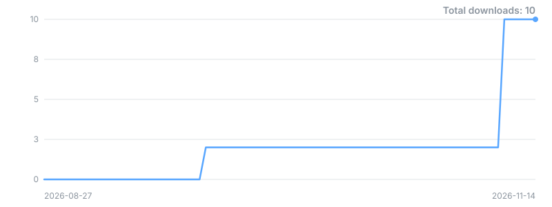

# aura-life

[](https://github.com/Redrum624/aura-life/releases)
[](https://github.com/Redrum624/aura-life/releases/latest)


-blue)

> **aura-life** — *a life that keeps running when nobody is watching.*

**An agent life-simulation engine.** Give a persona a `LifeService` and it
acquires an inner life that runs whether or not anyone is talking to it: energy
and fatigue cycles, a daily plan it writes for itself, goals it invents and
abandons, moods that drift, a home with rooms and weather, a job, money, errands,
skills, friendships, and experiences worth mentioning next time you speak. Two
lines of setup and twenty ticks later, your agent has had a day — and can tell you
about it.

The usual alternative is a prompt that *claims* a backstory, regenerated from
scratch on every request. This is the other thing: **state, not narration.** The
engine holds no LLM, no HTTP layer and no user accounts; everything belonging to
the surrounding application arrives through a thirteen-function hook registry the
host fills in at startup. A host-free process still runs a complete life — just
without narration, real weather or place lookups.

<p align="center">
  <a href=".github/concept-map.png"></a>
</p>

<p align="center"><sub>
  Click to enlarge · source:
  <a href="docs/diagrams/concept-map.mm.md"><code>docs/diagrams/concept-map.mm.md</code></a>
  (interactive markmap) and
  <a href=".github/concept-map.svg"><code>.github/concept-map.svg</code></a>
</sub></p>

## Why aura-life

- **N agents, one world, one process.** No `LifeService` state lives in a
  module-level singleton, so instances cannot collide — three agents sharing one
  `WorldEnvironment` is an asserted test, not an aspiration. (The two
  per-persona caches that *are* process-global are keyed by persona id and have
  explicit teardown.)
- **The host seam is thirteen functions wide.** `aura_life.hooks` imports `typing`
  and nothing else, which is the structural guarantee that plugging in your
  application can never drag your application into the simulation.
- **It degrades instead of dying.** Miss a hook and that one feature reports
  "unavailable"; the tick still completes. The unguarded exceptions are counted,
  named, and pinned by a test rather than left for you to find.
- **The public surface cannot move by accident.** 128 exported names, pinned
  against a committed snapshot; regenerating it is opt-in and shows up in the
  diff.
- **32,088 lines across 82 modules and 32 subpackages** as extracted — 32,949
  across 83 after the pre-publication hardening, 48,971 across 103 files and
  35 subpackages at 0.6.0 — with exactly one runtime dependency, and only on
  Windows.
- **The defects are in the repo, not in a private tracker.** `DEFERRED.md` names
  what is shipped unfixed and what it costs you.

## Install

```bash
python -m pip install aura-life
python -m pip install "aura-life[scheduler]"    # ...or with the optional extra
```

To work on it, or to have a sibling project depend on a checkout in place, install
it editable instead:

```bash
git clone https://github.com/Redrum624/aura-life.git
python -m pip install -e ./aura-life
python -m pip install -e "./aura-life[scheduler]"    # ...or with the optional extra
```

Both `pip` lines are run from the directory that *contains* the checkout, so a
sibling project can depend on it in place with `-e ../aura-life`.

- **`[scheduler]`** installs `apscheduler`. Only `LifeService.start()` needs it —
  that is the background thread that ticks the simulation on real-world intervals.
  Without it `start()` logs `APScheduler not installed. Life simulation will run
  manually.` and returns; **you drive the ticks yourself, which is what the
  quickstart below does.** The quickstart's output was produced in an environment
  where `HAS_APSCHEDULER` is `False`.

  **`start()` needs a running asyncio event loop.** APScheduler's
  `AsyncIOScheduler` binds to the *running* loop at start time, so calling
  `start()` from synchronous code has no loop to bind. That is not an error you
  have to handle: the scheduler logs why and falls back to exactly the manual
  mode above, so a synchronous host behaves the same whether or not it installed
  this extra. If you want the background ticks, call `start()` from inside an
  event loop (an async web server, or `asyncio.run()`); otherwise drive
  `force_all_ticks()` yourself on whatever clock you own.
- **`tzdata`** is a hard dependency on Windows only (`sys_platform == "win32"`),
  and is installed for you. Windows ships no system IANA timezone database, and
  without it every persona timezone silently falls back to server-local time.

## Quickstart

Two personas living in one shared world, with no host application at all.

```python
"""Two personas, one shared world, no host application."""
import logging

from aura_life import LifeService
from aura_life.world import WorldEnvironment

# One WARNING per activity tick is expected with no host -- see "Limitations".
logging.basicConfig(level=logging.WARNING, format="%(levelname)s %(message)s")

world = WorldEnvironment()           # one world...

agents = [                           # ...two lives in it, one SQLite file each
    LifeService(
        db_path=f"{name}.db",
        persona_id=name,
        world_environment=world,
        occupation=occupation,
        interests=interests,
    )
    for name, occupation, interests in [
        ("mara", "baker", ["bread", "weather"]),
        ("theo", "nurse", ["running", "jazz"]),
    ]
]

# There is no public tick(): the caller owns the clock. LifeService never ticks a
# world it was handed -- a shared clock belongs to whoever created it.
for _ in range(20):
    world.tick()
    for agent in agents:
        agent._scheduler.force_all_ticks()

for agent in agents:
    s = agent.get_status()
    goal = (s["goals"]["active_goals"] or [{"title": "-"}])[0]["title"]
    print(f"{agent._persona_id:5} mood={s['affect']['mood']:9} "
          f"energy={s['energy_level']:9} "
          f"activities={s['recent_activities_count']:3} goal={goal!r}")

w = agents[0].get_status()["world"]
print(f"world {w['time_of_day']}, {w['weather']}, {w['season']} - both agents see this one")
```

What it actually prints (exit code 0, `mara.db` and `theo.db` created, nothing
else written):

```text
WARNING Failed to persist activity emotions: aura_life hook 'get_config' is not configured; the host application must call aura_life.hooks.configure(get_config=...)
    ... that same WARNING roughly 40 times — once per activity tick per agent.
    Runs have produced 38, 39, 40 and 42; the count is not deterministic.
    Not an error; see Limitations. Elided here only for readability.
mara  mood=neutral   energy=low       activities= 20 goal='Spend some time on weather'
theo  mood=neutral   energy=low       activities= 20 goal='Spend some time on running'
world afternoon, rainy, autumn - both agents see this one
```

(Run again for 0.6.0: exit code 0, 42 of those WARNINGs, nothing else on
stderr.)

The last three lines differ from run to run: `WorldEnvironment` starts from the
wall clock by default (see point 2 below for how to give it a different one),
weather is random, and goals are generated. What is stable is the
shape — both agents advance, both keep their own database, and both read the same
world.

Five things in that snippet are load-bearing and easy to get wrong:

1. **`world_environment=` makes the world shared, and shared means yours.**
   `LifeService` skips its own `self._world.tick()` when it was handed a world, so
   nothing advances until *you* call `world.tick()`. Omit the argument and each
   service builds and ticks a private world instead.
2. **The world carries the clock, and everything that measures elapsed time reads
   it.** `WorldEnvironment(now=...)` takes any zero-argument callable returning a
   naive `datetime` — it defaults to `datetime.now`, so the line above is the wall
   clock as it always was. `LifeService` hands `world.now` to `EnergySystem`, so a
   world on a simulated clock produces a simulated circadian rhythm across every
   agent sharing it, with no per-engine wiring and no monkeypatching of
   `datetime`. A consumer whose time comes from a tick counter rather than a
   callable subclasses `WorldEnvironment` and overrides `now()`; the override
   still reaches energy. Without this, `hours_awake` measures how long *your
   process* has been alive, which makes the engine unreplayable and untestable —
   see `tests/test_energy_clock.py`. The same clock answers whether the persona
   is on shift (the energy tick's work stress, the career block of
   `get_status()` and of the state export) and drives the energy tick's daily,
   weekly and monthly continuity cycles and its weekly rhythm. Her day plan is
   read on it too, in her local time (her timezone's persona clock when she has
   one, else the world's): which day's plan she is on, the slot she is in and
   the next one in `get_status()`, `get_life_context()` and the state export,
   where the location sync puts her, what the activity tick follows, the plan
   tick's silent revisions, whether a plan from `add_conversation_plan` is for
   an hour already passed, and which slots are still ahead when
   `apply_schedule_override`, `schedule_meeting_arrival` or a transit arrival
   rewrites the day — see `tests/test_career_clock.py`,
   `tests/test_world_clock_routes.py` and `tests/test_planner_clock.py`.
3. **`db_path=` is effectively required.** With no host configured there is
   nothing to resolve a path from, and the constructor raises `ValueError` rather
   than guessing. With a host configured you may omit it and get
   `data_dir/<persona_id>/life.db`.
4. **`agent._scheduler.force_all_ticks()` runs the five internal ticks**
   (`world`, `energy`, `plan`, `activity`, `goal`) once each, synchronously. This
   reaches through a private attribute because there is no public equivalent —
   see [Limitations](#limitations).
5. **Pass everything by keyword.** `LifeService.__init__` takes 24 positional
   parameters; `persona_id` is the ninth.

`tests/test_multi_instance.py` is the executable version of this quickstart, with
assertions: three agents, one world, no `ERROR` records, no state leaking between
databases.

## Module index

Thirty-five subpackages. Each owns one slice of the simulation and talks to the
others only through `LifeService`, which is the orchestrator — engines never call
each other directly.

| Subpackage | What it owns |
|---|---|
| `activities` | Activity selection and execution, and the narrative line each one produces. What she does next is what serves her best right now (`activities.choice`): her needs weighed by her traits, what she is into (interests, comfort zones, tastes, media, substances), her goals, wants and mood, less the effort; her habits for that part of her day then raise a familiar activity's weight before the cut to five (×1.5 at most) and lower an overdone one's after it (÷1.5 at most, never out of the five). What she does can go well, only half well or wrong -- likelier when she is tired, low or new to it -- and is told accordingly. |
| `affect` | Background mood — the emotional undertone that outlives a spike — and days that differ: each has a quality of its own, drawn in her first waking hour. Stress is what weighs on her: stressors, each named in words ("money worries", "putting off finishing that project"), with a severity, how far it is hers to end and when it lapses; her level is what they weigh, never 0 while one is listed, and each clears when its cause does (she eats, sleeps, gets paid, runs the errand, her shift ends). How she copes is her traits': problem-focused, avoidant or social. The hours a host was down are lived hours for all of it: its catch-up (`catch_up_from_downtime`) ticks her affect over the whole gap, as her hunger, up to where her live ticks began, so her loneliness after eight hours away is what eight hours give, whichever of the host's first tick and its catch-up runs first. |
| `behavior` | Routine detection from repeated activity; habits from a dated four-week activity history (comfort for what she did often lately, staleness for what she overdid, per part of her day, fading over days); creative artifacts: poems, sketches, playlists. |
| `body` | Physical state — general health, minor ailments, an optional hormonal cycle — and its pull on mood and energy. |
| `chaos` | Cross-cutting randomness: unexpected twists mid-activity, serendipity, entropy injected into the other engines. |
| `cognitive` | Focus and flow state, rumination loops, the quality of attention. |
| `context` | Assembles the prompt-context sections a host feeds its LLM, under a token budget, and her moment (`context.moment`, "The moment" below). |
| `continuity` | The slow cycles — anniversaries, growth snapshots, life chapters — that build long-term meaning. |
| `drive` | Motivational drives beyond goals: curiosity sparked by experience, avoidance and its accumulating guilt -- more of both for an avoidant persona. |
| `emotion` | Concurrent emotions with intensity, decay and blending; a three-tier feelings wheel; text emotion analysis; persistence across restarts; appraisal -- what an event means to her (her goals, needs and values, whose doing it was, how expected it was, her volatility), and so what she feels about it. |
| `energy` | Energy levels, circadian rhythm, boosts, and sleep as a state with a duration: sleep pressure (fatigue) that builds by the hour awake, and each night drawn from the persona's own schedule. |
| `errands` | An everyday to-do backlog that accrues, slips to overdue, and nags through `affect`. |
| `expression` | Connection awareness (online/offline, response timing) and communication style. |
| `goals` | Self-generated goals with a full lifecycle: invented from personality and experience, pursued, completed, abandoned. Her own first -- her personal goal, interests, values and struggles, and daily intentions from her values and interests -- then the best fits of her setting's pools. |
| `habitation` | The living space — tidiness decays, cleaning restores it, the room reads as lived-in. |
| `identity` | Emergent self-identity facets reinforced by activity, plus mental models of the user and of NPCs. |
| `intimacy` | Private desire, arousal and intimate feeling -- never in a work shift or her sleep window; an optional intimacy rate scales how often. |
| `job` | Career and work life: a weekly shift schedule, an `on_shift` state, progression over time. |
| `life_events` | Significant moments — achievements, discoveries, surprises — recorded as things worth sharing. |
| `location` | The known-places registry and familiarity, home-city resolution, and the device-location store. |
| `memory` | The memory stream: the episodes of her life -- what she did, what her people did, what went wrong, small moments, work days, goals, milestones -- recalled by recency, importance, relevance and mood, with a strength that fades and grows each time she recalls it (`LifeService.recall`). |
| `memory_time` | Subjective time perception, seasonal consciousness, nostalgia, life narrative, anticipation. |
| `money` | A light evolving ledger: income, purchases, financial stress. Pay and bills are monthly; everything else is on the world clock, whatever the host's tick: her purchases are drawn per world hour against a monthly budget from what is left after the bills (her spending habit sets the share: the default spends it, a frugal persona saves, a spender runs down), and an activity is paid for once in its hour, never when she cannot afford it. A new persona starts with no financial stress (1.5 months of her expenses); a saved one keeps her balance and the last hour she spent in, so the hours a host was down are drawn once after a reload, whichever of its first tick and its catch-up runs first. |
| `persona_evolution` | Slow personality drift from lived experience, bounded by a maximum drift. |
| `personas` | The persona pipeline: genre randomisation, personality configuration, the profile database and parser, place and appearance generation, and `PersonaParameters` — the eight traits (authored, or read from trait text by one negation-aware matcher) and the one table through which they set the engines' numbers. |
| `planner` | The daily plan — generated once a day, followed through, revised on user command. Every slot is an activity of her setting (the day's anchors by tag), a slot governs its whole hour, and her free hours are filled by what she is into and how her traits lean her. On a low day she swaps to the comforts she would pick -- company too, if she copes by seeking it. For each hobby slot her habits for that part of the day raise a familiar activity's score before the cut to six (×1.5 at most) and lower an overdone one's weight after it (÷1.5 at most, never out of the six), as for her own picks between slots. |
| `sanity` | The one interior number that integrates the others and can break: a per-persona baseline, blows down, recoveries up, drift on the world clock, a graded word (`sound` to `broken`) the rest couples to. |
| `scheduler` | The tick loop. APScheduler-backed when the extra is installed; `force_all_ticks()` either way. |
| `settings` | Setting packs — the world a persona lives in, as data: activities (optionally restricted to persona ids, and tagged for what the engines know them as), places, what the people in her life do, what can happen to her, wants, goals, nostalgia, holidays, intimacy. Registered by key (`register_setting`); every engine reads its catalogues from the persona's setting, a setting without its own sleep, nap or meal gets the library's, and `contemporary` — today's catalogues, moved unchanged — is the default. |
| `shadow` | The darker inner psychology: felt insecurity, temptation and transgression, secrets. |
| `skills` | Competencies that grow with practice and emit milestone texts when they cross a threshold. |
| `social` | NPC interactions, social events, friend activity -- each person's kind (`friend`, `family`, `estranged`, `threat` ...) choosing what they do: a threat never checks in, someone she is estranged from reaches her unanswered. A friend's contact eases her loneliness; anything from a threat or someone she is estranged from is a stressor, never news to share. `Household`: personas who live together, each seeing the others' live state, and sharing what they do together in both logs. |
| `sustenance` | Hunger, meals and nutrition — wired to `energy` on one side and `money` on the other. |
| `transportation` | Travel-time estimation and the persona's get-around mode. |
| `world` | The shared world: locations, weather, seasons, the clock, cherished objects. |

Nine modules sit at the top level:

| Module | What it is |
|---|---|
| `life_service.py` | The orchestrator. Every engine hangs off it; it owns the database and routes signals between subsystems. By far the largest file. |
| `models.py` | The shared dataclasses and enums the engines exchange. |
| `schedule.py` | Weekly persona schedules and the per-persona schedule cache. |
| `conversation_session.py` | Per-conversation session state. |
| `hooks.py` | The host-hook registry. Imports `typing` and nothing else. |
| `defaults.py` | The one library-supplied hook implementation, `persona_now`. |
| `internals.py` | An eight-line unstable re-export namespace. |
| `__init__.py` | The curated facade — the 128 stable names. |
| `_safe_ids.py` | Private. Persona-id validation and containment-checked path joins. |

### The `Intimacy Rate:` profile field

A profile's optional `Intimacy Rate:` (under `== ENGINE SEEDS ==`, 0..1; `PersonalityDefinition.intimacy_rate`) scales the chance of an intimate activity on each activity tick: 1.0 is the chance a persona has without one, 0.5 half of it, 0 never. Left out, it is unset and nothing changes — there is no default rate. Whatever the rate, an intimate activity never takes a work shift, a commute, a class or study, nor — for a persona who sleeps — a moment inside her sleep window. What each rate gives, as a share of a neutral persona's waking activity ticks (three simulated days at the scheduler's own cadence, the default setting, one persona whose random draws are the same in every run):

| `Intimacy Rate:` | seed 1 | seed 2 | seeds 1–6 |
|---|---|---|---|
| unset | 16.9% | 7.6% | 14.3% |
| 0.1 | 2.8% | 2.1% | 2.8% |
| 0.25 | 6.3% | 6.9% | 6.3% |
| 0.5 | 14.8% | 11.1% | 10.0% |
| 1.0 | 16.9% | 7.6% | 14.3% |

The share is not proportional to the rate: arousal she does not act on builds, and raises the chance again.

### Households

Personas who live together share one `Household` (spec section 4.5): each one's `LifeService` is handed the same object and joins it under its `persona_id` when it is built.

```python
from aura_life import Household, LifeService
from aura_life.world import WorldEnvironment

world, home = WorldEnvironment(), Household()
lina = LifeService(db_path="lina.db", persona_id="lina", world_environment=world, household=home)
roberta = LifeService(db_path="roberta.db", persona_id="roberta", world_environment=world, household=home)
```

Each one's life context then says where the other is and what she is doing right now -- "Roberta is asleep", "Roberta is here with you (reading)" -- read from the other's live state (never what she does in private) (`get_status()["social"]["household"]` carries the same), and a persona's social-circle entry for a housemate draws no ordinary NPC event. The link is runtime only: `stop()` leaves the household and `start()` joins it again, nothing about one persona is saved in another's database, and a housemate who is not joined is an ordinary NPC in the others' circles. A profile's `Household:` line (`PersonalityDefinition.household`) names whom a persona expects; the status lists those not joined as `missing`.

They also do things together. An activity tagged `"joint"` that one of them is about to do can take in a housemate who is free for it -- awake, where she is, in an hour her plan leaves free -- and it is written into both logs, each from its own side ("Roberta joined her" / "She joined Lina"), done once by each. Joining takes the joiner's hour: her plan's slot for it becomes that activity, where it is, so she stays there for the rest of the hour. A setting pack that wants this tags its own activities `"joint"`; the contemporary pack tags its meals and the things two people do at home or out together. Who asks is whoever's activity tick comes first: ticked in lock-step (every member at the same instants, in the same order, as `tests/sim_helpers.py` does), joint activities are deterministic per seed; on a host whose members tick on their own timers, which member asks -- and so what they do together -- can change from run to run.

### Outcomes, and what she feels about them

Each activity she does goes well, only half well or wrong. The chance it does not go well is 0.08 on a good day, plus up to 0.2 for how demanding it is for the energy she has, up to 0.3 for a low mood and 0.1 for a beginner at the skill it trains -- at most 0.5, a third of that an outright failure (`aura_life.activities.activity_engine`, where every number is written down with what it gives: over three simulated days, 84.9% of activities went well, 10.2% half well and 5.0% wrong). What happened is told in her setting's words (`Activity.outcomes`, falling back to the library's neutral ones); a success keeps the narratives it always had.

What she feels about it is her appraisal of it (`aura_life.emotion.appraisal`), not a fixed table: a success is felt as the activity's own emotions, a failure as frustration -- or annoyance, for a commitment she had to keep -- with relief or resignation for the part she doubted; the goal it was for adds pride or disappointment, each need she came with its own feeling met or unmet, a value she holds fulfilment or discouragement; and her volatility scales it all. It reaches the host's `EmotionEngine`, her mood and her memory. A failure moves no goal and fulfils no want; what did not go well is nothing to share.

```python
from aura_life.emotion.appraisal import AppraisalEvent, appraise
from aura_life.personas.parameters import PersonaParameters

spikes = appraise(AppraisalEvent(what="reading", outcome="fail", emotions={"absorbed": 0.2, "content": 0.15},
                                 success_chance=0.9),
                  PersonaParameters(volatility=0.9), goals=[], needs={}, values=[])
print({s.emotion: round(s.intensity, 2) for s in spikes})   # {'frustrated': 0.47, 'resigned': 0.05}
```

An optional `appraisal_llm=True` (default off) asks the host's LLM what she feels instead; its reply is validated -- only feelings the emotion vocabulary knows and that fit how it went (a failure is never felt as joy), each clamped to 0..1, at most three -- and a missing or failing hook leaves the deterministic appraisal exactly as it is.

Her days differ, too. Once a day, at her first waking tick outside her sleep window, the day's quality is drawn (`AffectSystem.new_day`): a shift of her mood's resting point, up or down, that lasts the day -- wider for a volatile persona, lower after a poor night. On a low day her plan gives way to the gentle things she likes best.

### Memory

What a persona lives becomes episodes of her memory stream (`aura_life.memory`, spec section 4.6), saved in her `life.db` as each one is written: what she did (as she would name it, with the housemates she did it with), what her people did ("a call from Mara"), what went wrong, small moments, a day at work, a goal reached or given up, a skill milestone, a finished book -- each with where, who, her strongest feeling, the valence of her mood at the time (for what she did, of how it felt to her: her appraisal of it) and how much it mattered. What she does in private is not recorded.

```python
for episode in lina.recall("the cafe", k=3):
    print(episode.gist())        # "Reading at the cafe, feeling absorbed."
```

`recall(query=None, k=3)` returns a list of `Episode` (on `aura_life` since 0.6.0; the stream itself, `MemoryStream`, is imported from `aura_life.memory` and defined in `aura_life.memory.store`). It ranks her episodes by recency (0.995 per hour since she last recalled one), importance, relevance to the query (the words they share, or the host's optional `embed` hook) and how well each fits her mood now. Unprompted recall (no query) weighs each by how much of it she still holds -- its retention, `exp(-t/S)` with t the days since she last recalled it -- so what she does not recall fades (a day on, an episode weighs 0.37 of itself; three days on, 0.05) while what she keeps recalling stays; a query-cued recall is not weighted by retention, so a good cue brings back a faded memory. Recalling an episode strengthens it: its strength S gains 1, so it fades more slowly from then on. `recall(..., reinforce=False)` reads the same episodes without strengthening them -- for a host that shows her memories rather than has her remember them. Importance runs from 0.1 for the purely mundane to 1.0, from her strongest feeling, whether the activity, place or person was new to her (unseen for a week, once her memory spans one) and whether anyone was there. The stream keeps her 2,000 most important episodes; `reset_state()` forgets them all. A gist is one plain sentence with no digits, addressed to her where it has a subject ("You spilled coffee on your shirt at the cafe, feeling annoyed.") -- never the transcript of what happened.

Reflection turns that stream into beliefs. Once the importance she has lived since her last reflection sums to 15.0 (Generative Agents' 150 on this library's 0.1..1 scale; removing reflection dropped their believability score from 29.89 to 26.88), she looks at the window and remembers what it adds up to -- a repeated activity with a person, a recurring place, a mood trend -- each as an episode of her own, tagged `belief`, its grounding episodes reinforced. Nostalgia now draws from a real episode at least 7 simulated days old when she has one, quoting its gist instead of one of the setting's ten generic fragments (which remain the fallback for a persona too new to have one yet). A life chapter, synthesised monthly, summarises the mean valence and dominant activities of the whole month it covers, read from this same stream -- not her mood at the moment it was written. An optional `reflection_llm=True` (default off) lets her ask the host's LLM for one more belief on top of the deterministic ones; a missing or failing hook leaves those exactly as they are.

### The user's turn

A host tells her about each user turn with **one** of two calls, never both: `observe_user_turn(text=None, *, sentiment=None, emotions=None, topics=None, disclosure=None, language=None) -> dict` (spec section 4.8), or the older `on_user_message(text, detected_emotion="", emotion_intensity=0.0)`, which is now that same turn with the host's detected emotion and returns nothing. The turn does everything a message always did (her energy's social boost, the conversation keyword triggers, the host's user model) and adds her appraisal of the user's emotion -- the host's `emotions` (name -> 0..1), or else what the text analyzer reads in `text`. She never copies it: a sad user raises her concern (more for a warm persona), a playful one amuses her, a glad one warms her, and hostility aimed at her (the turn speaks to her: "I hate you", not "I hate my job"; a host's "angry" or "irritated" is hostility, as the analyzer's own "mad" is, and a host's "grateful" or "affectionate" warmth, as its "thankful" and "loving" are; a host's "love", which her vocabulary has no name for, warms her as "loving" does) hurts or irritates her, the more volatile she is the more irritation. She feels that (the host's `EmotionEngine` and her mood), her empathy hears the user's strongest emotion with her trust in them, and her trust in the user falls on hostility at her and rises on warmth and on `disclosure` (0..1). Hostility at her is contact, not a meaningful interaction: it eases her loneliness less (0.05, against a turn's 0.15) and does not count as the last time she really talked with someone. A turn that left a trace -- the host's `topics`, a `disclosure`, or a feeling in her -- is an episode of her memory, tagged `conversation` (and the turn's `topics`): a gist of what the turn was to her ("They lashed out at you", "They opened up to you", "They talked with you about work"), never the user's words, which the host keeps; a neutral turn leaves none. Every turn's world instant is kept by `last_user_turn_at`, and her state saves it.

```python
turn = lina.observe_user_turn("I'm so sad today")
print(turn["valence"], turn["persona_emotions"], round(turn["trust_delta"], 4))
# -0.5 {'concerned': 0.42250000000000004} 0.003
turn = lina.observe_user_turn("I hate you")
print(turn["persona_emotions"], round(turn["trust_delta"], 4))
# {'irritated': 0.4, 'hurt': 0.4} -0.005      (hostility at her: her trust falls)
print(lina.recall("hard time", k=1, reinforce=False)[0].gist())
# They told you about a hard time at home, feeling concerned.
```

`valence` is that of what she feels (else the host's `sentiment`, else 0.0). The text analyzer (`aura_life.emotion.text_emotion_analyzer`) matches whole words, so "dismiss you" holds no "miss you"; a word or phrase starting one to three words after a negator in its clause is not felt ("I'm not happy about this at all" holds no joy); curly apostrophes read as straight ones; and a basic French lexicon reads each word as an English entry ("Je suis tellement triste aujourd'hui" is sad; `language="en"` reads English only). The conversation keyword triggers go through the same words and negation: "I don't love you" is no affirmation, and "glove" says nothing of love.

### The user over time

How close she is to the user is a relationship depth, 0..1 (`LifeService.relationship_depth`; `aura_life.expression.relationship`, where every number is written down with where it comes from). It grows with time -- each world day with a user turn adds a little -- and with reciprocity: a disclosure deepens the bond only when it answers one from the other side, the user's `disclosure` on a turn and hers when the host marks something of her life shared (`mark_shared`). Messages alone do not deepen it: sixty turns in one sitting are one contact day. After 7 days without a user turn it regresses, a little more each silent day, and her next turn starts from there. Depth sets the relationship stage, whose names stay (`early`, `comfortable`, `deep`, at depths 0, 1/3 and 2/3); a save from before depth existed loads to the depth its stage begins at.

The style hint (`expression.get_style_hint()`) no longer sets a register for every persona ("complete sentences", "lol", emoji): it is her own `communication_traits`, then one distance line by depth -- still getting to know them and keeping what is personal, then teasing, then inside jokes and bluntness (`expression.distance_line()`).

When the user has been away 8 hours or more, she is in an `after_absence` state (`LifeService.after_absence`: hours, intensity 0..1, feelings, her attachment style, and whether the absence is still going on). Its course follows her `attachment_style`: secure, glad and curious; anxious, worried and then, past the course's half, hurt; avoidant, she notices and stays cool. It rises over the first week and the anxious persona feels it most. When the user comes back, the absence that just ended stays her state while that conversation goes on. It is computed here and rendered by the host's moment with her `state_expressions`; `export_outer_state()["expression"]` carries it with `depth`.

```python
# lina: attachment_style="anxious", communication_traits=["Dry and brief"], on a world clock
lina.observe_user_turn("my dad is sick", disclosure=0.8)   # they open up; she has not yet
print(round(lina.relationship_depth, 3))                   # 0.05 -- one contact day
print(lina.expression.get_style_hint())
# Dry and brief. You are still getting to know them: keep what is personal for when they open up, ...
state = lina.after_absence                                 # three days later
print(state.feelings, round(state.intensity, 2), state.ongoing)   # ('worried',) 0.4 True
# eight days after that: ('hurt',), and her depth has fallen to 0.041
```

### The moment

`LifeService.get_moment(user_text=None) -> Moment` (`aura_life.context.moment`, spec section 4.10) is what is true of her now, in a few plain lines, deterministic and with no LLM. `get_life_context()` stays, for dashboards; the moment is what goes in her prompt.

- `situation` -- where she is, what she is doing, the time of day and the weather.
- `undercurrent` -- the state that drives her most and at most one more: tiredness and sleep pressure, her mood, hunger, illness, drink or a hangover, stress, the user's absence, her shadow's unease or guilt. Her shadow's unease ("Something has you on edge") is said only when none of what raises it -- her loneliness, her stress, a mood under neutral -- is itself in the running: beside "You're lonely" it would be one cause told as two states. It is said when those causes are each too small to be said and add up, and when it outlives its cause. Each is a short plain lead ("You're pretty hungry", her mood's own line) and then her `state_expressions` entry for it as written; a persona without one gets the library's neutral line for that key (`NEUTRAL_EXPRESSIONS`, one per `STATE_KEYS` key; an AI persona reaches only `AI_STATE_KEYS`, the states without a body). When the user's words touch one of her states ("what are you eating?" and her hunger), that one comes forward.
- `on_mind` -- at most two cues: an episode of her memory stream, a rumination, a goal, a curiosity or something she puts off, a stressor, her next plan slot, ranked by salience x novelty x (1 + relevance to `user_text`). Relevance is the memory stream's own (`MemoryStream.relevance`: the host's `embed` vectors when it has the hook, else the words they share). A cue that is rendered loses half its novelty and wins it back over a day of world time, saved in her `life.db`; only the memory cues rendered are reinforced, as a recall would (the rest of what she remembers is read without a trace).
- `to_share` -- at most one unshared thing she remembers, `Share(id, text)`, with its stable id. The moment marks nothing: the host calls `mark_shared(to_share.id)` once she told it, and the next moment offers something else. An item her memory tells together with another (a shareable and its life event) is one piece of news: marking either id marks both.
- `speech` -- two to four lines on how she speaks: a length target (from a `communication_traits` entry that names a number of sentences, else two or three; one less when she is tired or low), at most one question, never naming her feelings or these notes, and the disclosure line of her depth with the user. `length` carries the same target as integers (`LengthTarget(min_sentences, max_sentences)`) for a host's token cap -- never parse the sentence.
- `unspoken` -- at most one line she keeps to herself: her newest secret, else what her shadow hides.

`Moment`, `Share` and `LengthTarget` are on `aura_life` (0.6.0) and stay importable from `aura_life.context.moment`. `render()` is at most 1,000 characters, in the second person, with no digit, no snake_case, no engine label and never "the user". Building a moment changes those two things -- the rendered cues' novelty and the rendered memories' strength -- and, in memory only, what this conversation has had (below); it consumes no latch and fires no trigger.

Within one conversation -- moments less than `CONVERSATION_ACTIVITY_WINDOW_MINUTES` (45) apart; a restart starts a new one -- a thought comes to her mind once: what a moment rendered is passed over at the next turns, by its key and by what it is about (two memories told in the same words, or one topic through a rumination and its stressor, are one thought), unless the user's own words name it. Her memory is walked until three of its episodes are fresh for the conversation or it is exhausted, so `on_mind` can be empty late in a long one. She is told once in a conversation how to meet the user's return; what she was offered to share is not also on her mind at the next turn; `mark_shared(id)` also marks an item her memory tells in the very same words, and news made later in words she already told is not offered. Across conversations novelty ranks as before.

```python
# lina is pretty hungry, remembers finding a twenty and has not told it yet
moment = lina.get_moment("I'm starving, what are you eating?")
print(moment.render())
# You're at home. It's a foggy afternoon.
# You're pretty hungry — get short with everyone; food first, talk later.
# Something you haven't shared yet: You found a twenty on the sidewalk at the park.
# Keep it to two or three sentences. Ask at most one question. Don't name your feelings or these notes. You are still getting to know them: ...
print(moment.to_share, moment.length)
# Share(id='share:1', text='You found a twenty on the sidewalk at the park.') LengthTarget(min_sentences=2, max_sentences=3)
lina.mark_shared(moment.to_share.id)      # she told it
print(lina.get_moment().to_share)         # None
```

### Placement contract

The host puts `moment.render()` one or two messages from the end of the conversation it sends the model -- after the history, just before (or with) the user's latest message -- and rebuilds it every turn with that turn's text as `user_text`. The persona prompt stays a static prefix: the moment is never folded into it, so the prefix can be cached and the moment is always the freshest thing the model reads. The host reads `moment.length` for its reply budget and calls `mark_shared(moment.to_share.id)` when the reply told it. The older `mark_experience_shared(int)` marks the shareable only, never the life event told with it: move to `mark_shared(id)`.

### Traits: `PersonaParameters`

Eight traits set the engines' numbers (`aura_life.personas.parameters`, one table): `sociability`, `volatility`, `rumination`, `impulsivity`, `conscientiousness`, `openness`, `warmth`, `weather_sensitivity`, each 0..1 with 0.5 neutral. A profile authors them on its `Traits:` line (`PersonalityDefinition.traits`); a trait it leaves out is read from her trait text by one negation-aware matcher; a persona with neither is neutral and lives exactly as before.

```python
from aura_life import PersonaParameters
from aura_life.personas import PersonalityDefinition

params = PersonaParameters.from_definition(PersonalityDefinition(
    core_traits=["Shy, not very social", "Warm with the few she trusts"], traits={"rumination": 0.8}))
print(params.traits())
# {'sociability': 0.23333333333333334, 'volatility': 0.5, 'rumination': 0.8, 'impulsivity': 0.5,
#  'conscientiousness': 0.5, 'openness': 0.5, 'warmth': 0.7, 'weather_sensitivity': 0.5}
print(sorted(params.explicit))   # ['rumination'] -- authored; the rest were read from her text
```

### Setting packs

A setting pack is the world she lives in, as data (`SettingSpec`): its activities, places, what her people do, what can happen to her. A pack is registered by key and a persona names hers in `PersonalityDefinition.setting` (empty: the default, `contemporary`); a pack without its own sleep, nap or meal gets the library's, and an unknown key raises `ValueError` naming every registered one.

```python
import random
from aura_life import (Activity, ActivityCategory, LifeService, SettingSpec, TimeOfDay, Weather,
                       get_setting, register_setting)
from aura_life.personas import PersonalityDefinition

register_setting(SettingSpec(
    key="harbour",
    activities=[Activity(name="mending nets", category=ActivityCategory.CREATIVE, energy_cost=0.05,
                         min_energy=0.0, duration_minutes=20, preferred_times=list(TimeOfDay),
                         preferred_weather=list(Weather), suitable_locations=["home"],
                         narrative_templates=["{Subj} mended a net"], thought_possibilities=["Nearly done."],
                         emotion_effects={"content": 0.1})],
    places={"home": "home"},
))
ada = LifeService(db_path="ada.db", persona_id="ada", rng=random.Random(1),
                  definition=PersonalityDefinition(id="ada", name="Ada", setting="harbour"))
print(ada._setting.key, get_setting().key)   # harbour contemporary
```

`unregister_setting(key)` removes a pack again (the default cannot be: replace it with `register_setting(spec, replace=True)`); `get_setting(key=None)` returns a registered one, the default with no key.

### Stress, and money

What weighs on her is a list of stressors, each in words, with a severity, how far ending it is in her hands, and when it lapses; her stress level is what they weigh. Each clears when its cause does: she eats, sleeps, gets paid, runs the errand, her shift ends. How she copes is her traits'. A host reads them in `get_status()["affect"]` (`stress`, `stress_sources`, `stressors`); the engine is `AffectSystem`:

```python
from datetime import datetime
from aura_life import AffectSystem

now = datetime(2026, 10, 5, 9, 0)
affect = AffectSystem()
affect.raise_stressor("money", now=now)
affect.raise_stressor("errands", now=now)
print(affect.get_status()["stress"], affect.get_status()["stress_sources"])
# 0.1 ['money worries', 'errands piling up']
affect.hold_stressor("money", False, now=now)        # she got paid: its cause is gone
print(affect.get_status()["stress_sources"])         # ['errands piling up']
```

Her money is on the hours scale of the world clock (the `money` row of the module index); `get_status()["finance"]` reads it -- for a new nurse on a world clock, three hours in: `{'feeling': 'comfortable', 'balance': 2775.0, 'monthly_income': 2600.0, 'monthly_expenses': 1850.0}`.

### The world clock

What decides her life reads the world's clock (`WorldEnvironment(now=...)`, see the quickstart's point 2), never the host's: a host whose world clock is not its wall clock -- one that simulates, pauses or replays time -- sees her days at the world's hours. An engine method that decides by time takes an optional keyword-only `now=` and, without it, reads the host's clock as before; `LifeService` always passes the world's instant (`self._world_clock()()`), and a host calling one of these methods itself should too (`CHANGELOG.md`, 0.6.0, "Notes for hosts", lists them):

```python
nurse._goal_engine.get_emotional_context(now=nurse._world_clock()())
# 'You recently let go of a goal and feel a bit adrift.'   (a new nurse, three world hours in)
```

`tests/test_world_clock_lint.py` holds the rest: it scans `src/aura_life` for every read of the host's clock (`datetime.now`, `time.time`, `date.today` ..., through any import alias) and fails on one that is not on its allow-list, where each remaining read carries its reason (real time by nature, a fallback taken only when the caller passes no instant, the host scheduler's downtime ...). `tests/test_world_clock.py` puts the host's clock years away from the world's and checks each decision follows the world.

### What a restart keeps

Her state lives in her `life.db`. `start()` loads it, `stop()` saves it, and a started service also saves it from its ticks at most an hour of world time apart; a service never started (the quickstart's) writes none of it back, so it cannot overwrite a saved persona with fresh defaults. Measured on a nurse three world hours in (started, ticked, `stop()`, then a new service on the same file and `start()`, two runs): of `export_inner_state()`'s blocks, `character_evolution`, `continuity`, `life_events`, `memory_time` and `sanity` came back equal; the others came back close to what they were, with values recomputed at the load (in one run her energy 0.22 to 0.27, her self-esteem 0.51 to 0.5, a need's satisfaction by up to 0.03; `chaos.last_chaos_type` reads `restored`). Not saved, by design: her household link (runtime only, see Households) and where her live affect ticks began after a reload (kept in memory, so a reload does not charge downtime as lived time). Her moment's novelty and the user's last turn (`last_user_turn_at`) are saved.

## The public surface

`aura_life` exports **128 names** and that is the stable API. 114 of them are
inherited verbatim from the origin project's engine package; `hooks` and
`HookNotConfigured` were added by the extraction, `clear_persona_schedule` in
0.2.0, `SanitySystem` -- the interior that can break -- in 0.3.0, and the
humanness program's ten in 0.6.0: `Moment`, `Share`, `LengthTarget` (the
moment), `PersonaParameters` (traits), `SettingSpec`, `register_setting`,
`unregister_setting`, `get_setting` (setting packs), `Household` and
`Episode` (the memory stream's unit).

```python
from aura_life import LifeService, Weather, Goal, hooks   # stable
```

### `aura_life.internals` — what it actually is

`internals.py` is eight lines. It re-exports **`LifeService`, all of `models`, and
all of `context`** — and nothing else:

```python
from aura_life.life_service import LifeService
from aura_life.models import *
from aura_life.context import *
```

Measured against the facade (0.6.0), it adds **18 names** beyond the 128 — and
**9 of those are leaked stdlib/typing symbols** (`Dict`, `List`, `Optional`,
`FrozenSet`, `Enum`, `dataclass`, `field`, `datetime`, `json`) that the wildcard
imports dragged in. The 9 real additions are `BehavioralTendency`,
`CalendarEntry`, `ErrandsState`, `InebriationState`, `IntimateActivity`,
`LOCATION_ENUM_TO_KEY`, `LifeContextBuilder`, `PlaceLocationState` and
`Stressor`. **It is explicitly not stable and may change in a minor
release.** It exists so the origin application could finish migrating without
being blocked on the facade; treat an import from it as a to-do, not an API.

**It does not re-export the subsystem classes.** `EmotionEngine`,
`TextEmotionAnalyzer`, `WorldEnvironment`, `EnergySystem`, `GoalEngine`,
`ActivityEngine`, `LifeScheduler`, `get_emotion_persistence`,
`clear_emotion_persistence`, the `personas` entry points and the humanness
program's helpers (`aura_life.memory`, `aura_life.emotion.appraisal`,
`aura_life.personas.parameters`, `aura_life.context.moment`,
`aura_life.activities.choice` ...) — **152 names declared in the `__all__` of a
public submodule** (0.6.0; this README counted 27 at publication), not counting the hook names
below — are on neither `aura_life` nor `aura_life.internals`.

**Everything else is reached by its real module path**, which is a supported,
working import — just not a stable one:

```python
from aura_life.world import WorldEnvironment
from aura_life.emotion import EmotionEngine, TextEmotionAnalyzer
from aura_life.energy import EnergySystem
from aura_life.personas import get_personality
```

(`aura_life.hooks` is the exception among submodules: it *is* exported by the
facade, so its 18 otherwise-unreachable names are reachable as
`aura_life.hooks.configure` and friends. One of them, `persona_now`, is declared
in both `aura_life.defaults.__all__` and `aura_life.hooks.__all__` — it counts as
a hook name, not a path-only one, because `from aura_life.hooks import
persona_now` works.)

A public home for the subsystem classes is a **v0.2** decision, not a bug —
nothing here is broken, and the paths above are how consumers import them today.

`tests/test_api_surface.py` pins `__all__` against a committed snapshot
(`tests/api_surface.json`), so the public surface cannot change without the diff
saying so. Regenerating that snapshot is opt-in: `API_SURFACE_WRITE_SNAPSHOT=1`.

## The hooks contract

The engine simulates a life; it does not own the machine it runs on. Config, the
LLM, weather, geocoding, images, the persona datastore and the persona clock all
belong to the host. `aura_life.hooks` is the single seam between the two, and it
imports nothing but `typing` — that is its guarantee that the seam can never drag
the host in.

A host registers implementations once, at startup:

```python
from aura_life import hooks

def _get_config():
    from myapp.config import get_config        # imported at CALL time, not install time
    return get_config()

hooks.configure(get_config=_get_config, get_llm_service=..., ...)
```

`configure()` refuses a name that is not a known hook, so a typo in a bridge fails
loudly at startup instead of silently at the first call months later. The pattern
that works is one thin wrapper per hook, each performing its import lazily so
monkeypatching in tests still works.

The thirteen hooks:

| Hook | What the host supplies |
|---|---|
| `get_config` | the configuration object (`.data_dir`, `.place_enabled`, …) |
| `get_user_data_root` | root directory for per-user data |
| `get_persona_datastore` | the persona's consolidated datastore |
| `get_image_service` | image / self-photo service |
| `resolve_outfit_for_context` | which outfit fits the current schedule context |
| `get_schedule_phase` | coarse phase of the persona's day (`"morning"`, `"evening"`, …) |
| `generate_and_update` | regenerate and persist the persona's visual description |
| `get_weather_service` | real weather observations (distinct from the world sim) |
| `get_llm_service` | the LLM client. Called synchronously on the persona's tick by the optional `reflection_llm` / `appraisal_llm` paths -- under `Household.lock` when she has housemates -- so the client must return or raise within a bounded time: that bound is the host client's (ruling T14-R2); a raise falls back to the deterministic result |
| `geocode` | place name → `{city, country, lat, lon, timezone}` |
| `resolve_timezone` | coordinate → IANA timezone string |
| `persona_now` | "now" in the persona's timezone — **the one hook with a library default** |
| `embed` | one vector per text, for the memory stream's relevance — **optional by design**: without it relevance is keyword overlap, and its one (guarded) call site says so at `DEBUG` only |

**An unconfigured hook raises `HookNotConfigured`, a subclass of `ImportError`.**
That inheritance is deliberate and load-bearing: these calls replaced
function-local `from config import get_config` statements whose failure mode was
`ModuleNotFoundError` (itself an `ImportError`), so every `except ImportError`
guard already written around those call sites keeps behaving exactly as it did.
Most call sites catch it, log a `WARNING`, and degrade that one feature to
"unavailable".

Registry helpers:

- `hooks.configure(**providers)` — register; idempotent, re-registering overwrites.
- `hooks.reset()` — forget everything, including the library's own default.
- `hooks.is_configured(name)` — is there *a* provider?
- `hooks.provider_for(name)` — *which* provider? (the only way to tell a library
  default from a host registration; see Limitations)

### `persona_now`, the one library default

`persona_now` is a clock, not a host resource, and the standard library already
has one. `aura_life/defaults.py` registers a `zoneinfo`-based implementation when
the package is imported. It exists because `LifeService.persona_local_now()` calls
that hook **unguarded**: without a default, every `activity` tick of a host-free
`LifeService` dies inside the scheduler, which swallows the exception and logs it
at `ERROR`. The library would import cleanly, construct cleanly, tick forever and
simulate nothing.

`defaults.install()` never overwrites a provider that is already registered, so a
host bridge that registers its own `persona_now` — a virtual or frozen clock, say
— cannot be silently downgraded to the system clock. `hooks.reset()` drops it
along with everything else.

## The two per-persona providers

Two host behaviours are per-persona rather than per-process, so they are
constructor arguments on `LifeService` rather than hooks:

| Argument | Called as | The engine then uses |
|---|---|---|
| `user_model_provider` | `provider(persona_id)` | `.bid_response_rate`, `.quiet_windows`, `.observe_message(...)`, `.get_engaged_topics(n)`, `.get_disengaged_topics(n)` |
| `follow_up_provider` | `provider(persona_id)` | `.create_trigger(trigger_type, topic=…, context=…, urgency=…, …)` |

Both are duck-typed — the engine never imports a class or an enum for either.
Where a follow-up type is needed it passes the enum member's **name** as a plain
string (`"MOOD_SHIFT"`, `"DEPARTURE"`, …) and the host adapter turns it back into
whatever type it uses.

Every `prompt_hint` carries what moved her (what, where, who, when: an episode,
a life event, her plan slot, a calendar row, or when the user last spoke), worded
to her in the second person with no number or engine label; with no such detail
the trigger is not created. When a hint is about something she may share, the
call also passes `share_id=` (the `"share:<n>"` / `"event:<n>"` id to hand to
`LifeService.mark_shared` once a reply used it) — but only to a follow-up object
that declares `accepts_share_id = True`; any other object gets exactly the call
above, no new keyword.

```python
class FollowUps:                       # the host's adapter, returned by follow_up_provider(persona_id)
    accepts_share_id = True            # opt in to share_id=

    def create_trigger(self, trigger_type, *, topic="", context="", urgency=0.5, share_id=None, **kw):
        ...                            # keep share_id; after the reply that used the hint:
                                       # life_service.mark_shared(share_id)
```

**Omitting both is the supported standalone path.** Every call site is guarded by
an `is None` check; the engine simply skips adaptive cooldowns and proactive
follow-up triggers. The quickstart above passes neither.

## Limitations

Honest list. None of these are theoretical.

**There is no public `tick()`.** Driving the simulation means
`svc._scheduler.force_all_ticks()`, which is a private attribute, and constructing
a shared world means `from aura_life.world import WorldEnvironment`, which is not
in the facade. Both are the documented way to do it today and both are v0.2
candidates (recorded in `DEFERRED.md`).

**`hooks.is_configured("persona_now")` is `True` with no host installed**, because
a library default *is* a registration. Use `provider_for` to tell them apart:

```python
from aura_life import defaults, hooks
hooks.provider_for("persona_now") is defaults.DEFAULT_PROVIDERS["persona_now"]
# True  -> the library's own clock; False -> the host's
```

**The `WARNING` a host-free tick emits is expected degradation, not a bug.** It
appears once per `activity` tick, per agent:

```text
Failed to persist activity emotions: aura_life hook 'get_config' is not configured;
the host application must call aura_life.hooks.configure(get_config=...)
```

`get_emotion_persistence()` calls `get_config` unguarded, but its caller in
`life_service.py` wraps the whole thing — so the feature degrades and the tick
completes. Note that the guard belongs to the *caller*: a new caller of
`get_emotion_persistence()` inherits the hazard, not the protection.

**Thirteen hook call sites are unguarded, and two of them sit on the `world` tick
path.** `_get_weather_service()` and `_geocode_trip()` both import their hook with
no `try/except`. A host-free consumer no longer reaches either — both paths now
begin with a `place_enabled` check that fails closed when `get_config` is
unreadable. **A host that registers `get_config` with `place_enabled` true and
omits `get_weather_service` walks into the first**, provided its agent owns its
world, is not an AI persona, and has a resolved lat/lon; injecting a `trip_llm` as
well reaches the second. The failure is silent, because `LifeScheduler.force_tick`
catches every handler exception and only logs it at `ERROR`.

`tests/test_hook_call_sites.py` is the authority for the census — it walks the
AST, pins the thirteen as an explicit allowlist keyed by module and function
rather than by line number, and fails when a new unguarded site appears.
`DEFERRED.md` carries the analysis and the ranked follow-ups.

**`LifeService.start()` needs `apscheduler`** (the `[scheduler]` extra) and is a
single-persona, background-thread design. For N agents in one process, drive the
ticks yourself as the quickstart does.

**Storage is one SQLite file per persona only while the library is host-free.**
Once the datastore hooks are configured the persona pipeline also creates
`<data_dir>/<persona_id>/profile.db` and a `<persona_id>_emotions.db`, and the
location subsystem writes a `.device_location.json` under the user data root.

**Relationship modelling is not here.** Persona↔user relationship state stayed in
the origin application on purpose — see `CHANGELOG.md`.

## Tests

```bash
python -m pytest tests -q          # 2,784 tests across 69 modules, no network
                                   # (whole, about 20 minutes here; split it by file to keep a run short)
```

The suite must be run in an environment with **no host application on
`sys.path`**; `tests/test_multi_instance.py` asserts that explicitly, because
otherwise every "works standalone" claim in it would be vacuous. The notable
files:

| File | What it protects |
|---|---|
| `test_multi_instance.py` | three agents, one world, no host — no `ERROR` records, no cross-contamination |
| `test_hook_call_sites.py` | the unguarded-hook census; fails on a new unguarded site |
| `test_api_surface.py` | `__all__` cannot change silently |
| `test_persona_parity.py` | persona generation still matches the pre-extraction golden |
| `test_humanness.py` | the humanness program's acceptance rows over three simulated days at the scheduler's own cadence: a no-profile control and two contrasting personas from `tests/fixtures/humanness_a_profile.txt` and `humanness_b_profile.txt` (the activity mix read outside work; the mood-label row's one failing case held as a strict expected failure and kept from reading worse than its recorded number, see `CHANGELOG.md` 0.6.0) |
| `test_world_clock.py`, `test_world_clock_lint.py` | her decisions follow the world's clock with the host's years away; no new read of the host's clock in the library |
| `test_smoke.py` | the package imports at all, and reports a version |
| `test_persona_id_safety.py` | a persona id can never escape `data_dir`, and is rejected rather than repaired |
| `test_calendar_datastore.py` | the calendar API works with and without a host datastore |
| `test_collection_caps.py`, `test_life_service_retention.py`, `test_emotion_history_retention.py` | every capped collection and every retention prune |
| `test_life_service_failure_modes.py` | the kill switch fails closed; failures log instead of vanishing |

`tests/test_world_clock.py` imports every module under `aura_life` (its
host-clock fixture walks them all), so the suite does reach each one; the same
"everything imports with no host application present" check by hand reports
102 at 0.6.0 — the 103 files minus `aura_life/__init__.py`, which is the
package being walked (82 of 83 at publication):

```bash
python -c "import pkgutil, importlib, aura_life; \
mods=[m.name for m in pkgutil.walk_packages(aura_life.__path__,'aura_life.')]; \
[importlib.import_module(m) for m in mods]; print(len(mods),'modules standalone')"
```

The parity golden and the API snapshot are committed fixtures. A missing one is a
**defect, not a fresh start**: both tests fail loudly rather than regenerating.
Regeneration is opt-in and requires the exact value `1`
(`PARITY_WRITE_GOLDEN=1`, `API_SURFACE_WRITE_SNAPSHOT=1`).

## Documentation

| File | What is in it |
|---|---|
| `CHANGELOG.md` | every release from 0.1.0 on; 0.6.0 (the humanness program) opens with notes for hosts |
| `DEFERRED.md` | the defect that was fixed before publication, the thirteen unguarded hook sites shipped unfixed, what the humanness program fixed and the limits it left, and the v0.2 API candidates |
| `LICENSE` | Apache-2.0, in full |
| `NOTICE` | the relicensing attribution — legally load-bearing, do not strip |

## Where this came from

aura-life was extracted from a larger private application by the same author,
who holds sole copyright in both and relicensed the extracted subset under
Apache-2.0. See `NOTICE`.

The extraction was a **pure move**: a golden snapshot of twenty simulated ticks
was captured against the pre-extraction code, and the post-extraction library
reproduces it byte for byte. Measured at extraction, **70 of the 78 moved
modules were line-for-line identical to their originals**, the remainder
differing only where imports had to be rewritten. `CHANGELOG.md` records what
moved, what deliberately did not, and what was fixed afterwards — because the
"no refactoring" contract
that made the parity proof meaningful ended at publication, and the security and
resource-leak findings from the pre-release audit were fixed rather than shipped.

## Downloads



## License

Apache-2.0. See `LICENSE` and `NOTICE`.

---

**aura-life** — *give a persona a `LifeService` and it starts having days.*
